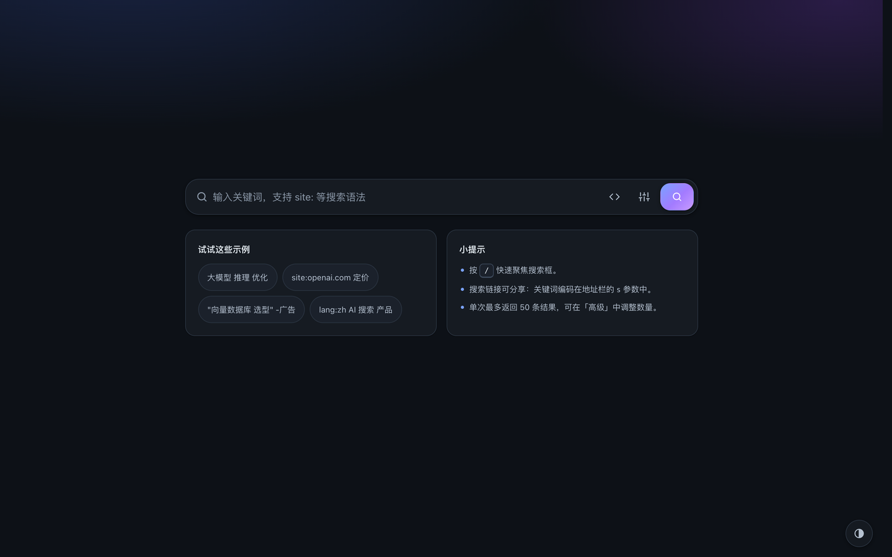
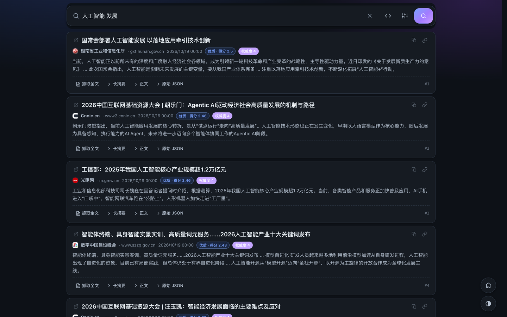

<div align="center">

# 🔎 AI 搜索平台

**可自托管的 AI 搜索与网页抓取平台 —— Rust + React，构建后只有一个二进制文件。**

把 DeepSeek Search & Fetch API 变成你自己的搜索界面：没有数据库、没有 Redis、没有独立前端服务器；
默认开启磁盘缓存，默认只监听本机，默认拒绝跨站请求。

[](https://github.com/shuaihaoV/ai-search-platform/actions/workflows/ci.yml)
[](https://github.com/shuaihaoV/ai-search-platform/pkgs/container/ai-search-platform)
[](LICENSE)
[](Cargo.toml)
[](CONTRIBUTING.md)

[✨ 功能特性](#-功能特性) · [📸 界面截图](#-界面截图) · [🚀 快速开始](#-快速开始) · [⚙️ 配置](#-配置) · [🔍 使用](#-使用) · [🔌 API](#-api) · [🏗 架构](#-架构) · [🛡 安全](#-安全) · [💻 开发](#-开发) · [❓ 故障排查](#-故障排查) · [📄 License](#-license)

</div>

---

## ✨ 功能特性

- **🔍 关键词搜索**：接入 DeepSeek Search API，返回标题、链接、摘要、AI 摘要、正文、
  站点信息、发布时间、权威度与重排分数等完整字段；支持一次获取最多 50 条结果。
- **📄 抓取网页全文**：接入 DeepSeek Fetch API，把任意公开网页转成 Markdown，
  在站内直接阅读，无需跳转。
- **🧩 搜索语法**：支持 `site:`、`-site:`、`-词`、`-"短语"`、`"精确短语"`、`lang:`、
  `after:`、`before:` 共 8 个操作符，界面里点击即可插入示例。
- **⚡ 内置磁盘缓存**：搜索与抓取结果默认缓存 1 天，SHA-256 键 + 原子写入 +
  后台清理；缓存命中不消耗上游额度，也不需要额外的 Redis。
- **🧾 安全的 Markdown 渲染**：`react-markdown` + `skipHtml`，HTML 一律当作文本；
  链接/图片只放行 `http(s)`，`javascript:`、`data:` 等协议直接丢弃。
- **🌗 三态主题**：跟随系统 / 浅色 / 深色，选择保存在 `localStorage`；无内联样式，
  适配严格 CSP。
- **📱 响应式与可访问性**：移动端与桌面端自适应，键盘可操作，对话框焦点管理，
  屏幕阅读器播报。
- **📦 单二进制分发**：release 构建通过 `rust-embed` 把前端产物**编译进二进制**，
  部署只需要一个可执行文件 + 少量环境变量。
- **🛡 安全默认值**：CSRF 同源校验、严格 CSP、SSRF 地址过滤、Host 校验、
  按 IP 限流、请求/响应体积上限、密钥脱敏 —— 全部开箱即用。
- **🐳 开箱即用的容器化**：多阶段构建、distroless 运行时（非 root）、多架构镜像（amd64/arm64）、
  `docker compose` 一键启动、内置健康检查。

> **项目状态**：`v0.1.0`，处于早期阶段，接口与内部常量仍可能调整；
> 欢迎通过 Issue / PR 参与共建，安全漏洞请走 [SECURITY.md](SECURITY.md)。

---

## 📸 界面截图

<div align="center">



*首页 —— 一个搜索框 + 示例问题与使用提示，支持 `/` 聚焦、语法面板、高级设置与主题切换。*



*搜索结果页 —— 标题、站点/时间信息、优质与权威度徽标、AI 摘要，以及「抓取全文 / 长摘要 / 正文 / 原始 JSON」操作。*

</div>

---

## 🚀 快速开始

**前置条件**：两种部署方式任选其一。

| 方式 | 需要 |
|---|---|
| Docker（推荐） | Docker 20.10+；方式一另需 docker compose v2 |
| 源码构建 | Rust **1.88+**、Node.js **≥ 20.19**、pnpm 9+ |

你还需要一个 DeepSeek API Key：前往 [DeepSeek 开放平台](https://platform.deepseek.com)
申请后填入配置。没有 Key 也可以先用 [mock 上游](#没有-api-key用-mock-上游本地联调) 体验界面。

### 方式一：Docker Compose（推荐）

```bash
git clone https://github.com/shuaihaoV/ai-search-platform.git
cd ai-search-platform

cp .env.example .env
$EDITOR .env                 # 至少填入 DEEPSEEK_API_KEY

docker compose up -d --build # 构建镜像并后台启动
# 等价于：make docker-up
```

打开 <http://127.0.0.1:8080> 即可使用。验证安装成功：

```bash
docker compose ps                                  # STATUS 应显示 healthy
curl -s http://127.0.0.1:8080/api/health           # {"status":"ok","version":"0.1.0"}
curl -s http://127.0.0.1:8080/ | grep -o '<title>[^<]*</title>'
# <title>AI 搜索平台</title>
```

`docker-compose.yml` 的关键设计：

- 服务名 `ai-search`，默认仅映射到本机 `127.0.0.1:8080`；可用 `HOST_BIND` / `PORT` 覆盖
  （公网场景建议保持回环映射、由反代暴露）。
- 容器内 `BIND_ADDR` 由 compose 固定为 `0.0.0.0:8080`（**无需修改 `.env`**，
  compose 的 `environment` 优先级高于 `env_file`）。
- 缓存目录 `/app/.cache` 由命名卷 `ai-search-cache` 持久化，`docker compose down` 不会丢缓存。
- 容器以非 root（distroless `nonroot`，uid/gid `65532`）运行，根文件系统只读，`/tmp` 为 tmpfs，
  丢弃全部 capability 并禁止提权；自带健康检查（`/api/health`）与日志轮转。
- `ALLOWED_HOSTS` 已由 compose 透传，默认 `localhost,127.0.0.1`（与仅监听回环一致）；
  公网/反代部署时改为对外域名（如 `search.example.com,www.example.com`）才允许外部访问。
- 可选访问密码 `PLATFORM_PASSWD` 也已由 compose 透传（默认空 = 不启用）；
  启用方法见[启用访问密码](#启用访问密码可选)，公网部署建议与反代访问控制叠加使用。

需要显式暴露到公网或换端口时（**强烈建议设置 `ALLOWED_HOSTS` 并配合反向代理**）：

```bash
HOST_BIND=0.0.0.0 PORT=8080 \
ALLOWED_HOSTS=search.example.com,www.example.com \
docker compose up -d
```

> 非回环绑定时，设置了 `ALLOWED_HOSTS` 才会强制校验 `Host`（未设置不校验，但启动日志会告警）；
> 公网部署请务必设置，防止 Host 注入 / DNS rebinding。

停止：`docker compose down`；查看日志：`docker compose logs -f ai-search`。

### 方式二：docker run

```bash
docker run -d --name ai-search --restart unless-stopped --init \
  -p 127.0.0.1:8080:8080 \
  -e DEEPSEEK_API_KEY=sk-xxxxxxxx \
  -v ai-search-cache:/app/.cache \
  --read-only --tmpfs /tmp:size=16m,noexec,nosuid \
  --security-opt no-new-privileges:true --cap-drop ALL \
  ghcr.io/shuaihaov/ai-search-platform:latest
```

> **必须挂载 `/app/.cache` 卷**：容器根文件系统是只读的，没有可写缓存卷时缓存写入会失败
> （接口仍可用，但每次都回源）。镜像内已预建 `/app/.cache`，空命名卷会继承其属主。
>
> 公网/反代部署时追加：`-e ALLOWED_HOSTS=search.example.com`（逗号分隔多个域名）。
>
> 启用访问密码时追加：`-e PLATFORM_PASSWD='$argon2id$...'`（单引号保护 `$`，避免被 shell 展开）。
>
> 也可以先本地构建：`docker build -t ai-search-platform:local .`，再把镜像名替换为
> `ai-search-platform:local`。
>
> 运行镜像基于 **distroless**（无 shell/包管理器），但内置静态 busybox 与常用 applet 软链，
> 需要进容器排障时直接 `docker exec -it ai-search sh`（或 `/busybox sh`）。

CI 在 `main` 分支、PR 与版本 tag 上构建多架构镜像（`linux/amd64`、`linux/arm64`）并推送到
`ghcr.io/shuaihaov/ai-search-platform`：`latest`（默认分支）、分支名、`vX.Y.Z` / `X.Y.Z` / `X.Y`
（Git tag）、`sha-<short>`（回溯用）。

构建链路：Node 24 + pnpm 11 构建前端 → Rust 1.88 release 编译并 `rust-embed` 嵌入 `dist` →
distroless 运行时。本机冷构建约 **78 秒**（M3 Pro/arm64），CI 首次会更久、有缓存后更快。

> 实测镜像体积**约 44.5 MB**（amd64，distroless 运行时；arm64 同基础镜像，体积基本一致）。
> 注：同一 commit 两次构建会有数十 KB 浮动（ThinLTO 链接非确定性），属正常现象。
> 可用 `IMAGE_TAG` 指定 compose 使用的镜像 tag，例如 `IMAGE_TAG=v0.1.0 docker compose up -d`。

### 方式三：从源码构建

```bash
git clone https://github.com/shuaihaoV/ai-search-platform.git
cd ai-search-platform

cp .env.example .env
$EDITOR .env                 # 至少填入 DEEPSEEK_API_KEY

make build                   # 前端构建 → 编译期嵌入 → target/release/ai-search-platform
make run                     # 读取 ./.env 并启动，默认 127.0.0.1:8080
```

`make build` 会依次安装前端依赖、构建 `frontend/dist`、执行 `cargo build --release`。
产物是**单文件** `target/release/ai-search-platform`，前端资源已嵌入其中，可以拷贝到任意机器运行。

> 只改后端时可 `make build-backend` 快速重编（要求 `frontend/dist` 已存在）；
> 未安装前端依赖时也能 `cargo check`，`build.rs` 会写入占位页以保证编译可用。

> 可选启用访问密码：先 `printf '%s' '你的密码' | ./target/release/ai-search-platform --hash-password`
> 生成哈希，按[启用访问密码](#启用访问密码可选)写入 `.env` 后重启。

### 方式四：下载 Release 二进制

从 [GitHub Releases](https://github.com/shuaihaoV/ai-search-platform/releases) 下载对应平台的
压缩包，解压后：

```bash
chmod +x ai-search-platform
cp .env.example .env         # 或直接 export 环境变量
./ai-search-platform
```

> Release 附件由 CI 在打 tag 时产出；若暂未提供对应平台，请使用 Docker 或源码构建。

### 没有 API Key？用 mock 上游本地联调

仓库自带一个纯 Python 标准库实现的 mock 上游，不消耗真实额度：

```bash
# 终端 1：mock 上游（默认 127.0.0.1:9000）
make mock

# 终端 2：指向 mock 启动应用
DEEPSEEK_API_KEY=test-key \
DEEPSEEK_BASE_URL=http://127.0.0.1:9000 \
make run
```

---

## ⚙️ 配置

### 环境变量（4 个常规 + 2 个可选加固）

| 变量 | 必填 | 默认值 | 说明 |
|---|---|---|---|
| `DEEPSEEK_API_KEY` | 否\* | 空 | DeepSeek API Key，以 `Authorization: Bearer <key>` 转发给上游。 |
| `DEEPSEEK_BASE_URL` | 否 | `https://api.deepseek.com` | 上游 Base URL。可带或不带 `/v1` 后缀（不会重复拼接）；自建反代或本地 mock 时改这里。仅支持 `http/https`；非回环地址必须使用 `https`，且不得携带凭据、query 或 fragment。 |
| `BIND_ADDR` | 否 | `127.0.0.1:8080` | HTTP 监听地址。默认仅本机可访问。 |
| `RUST_LOG` | 否 | `info` | tracing 日志过滤。例：`debug`、`ai_search_platform=debug,tower_http=info`。 |
| `ALLOWED_HOSTS` | 否 | 空（不限制） | 可选的 `Host` 白名单，逗号分隔（如 `search.example.com,www.example.com`）。用于公网/反向代理部署防 DNS rebinding：绑定回环时，回环 Host 之外只放行白名单；绑定非回环时，**设置后才校验**（回环 Host 始终放行）。条目不区分大小写，忽略端口与末尾的点。 |
| `PLATFORM_PASSWD` | 否 | 空（不启用） | **可选访问密码**，值为 **Argon2id PHC 哈希**（不是明文，形如 `$argon2id$v=19$m=19456,t=2,p=1$...`）。设置后首页显示密码框，未验证无法调用 `/api/search`、`/api/fetch`；登录换取 7 天有效 token。用 `--hash-password` 从 stdin 生成（密码 8–256 个字符）。**写入 `.env` 时必须用单引号包裹**（哈希含 `$`，会被 dotenvy 当作变量替换）；留空 = 关闭该功能，行为与之前完全一致。详见[启用访问密码](#启用访问密码可选)。 |

\* **缺失 `DEEPSEEK_API_KEY` 时服务仍能启动**：`/api/health`、`/api/config` 与静态页面均正常，
但 `/api/search` 与 `/api/fetch` 返回 `502` + `code: "upstream_not_configured"`，
便于先验证部署骨架。

> `DEEPSEEK_BASE_URL` 会作为缓存键的身份部分 —— 切换上游后不会复用旧缓存。

### `.env` 的加载规则

- 服务启动时**只读取当前工作目录下的 `./.env`**（`dotenvy::from_path(".env")`），
  **不会向上级目录查找**，因此 `~/.env` 之类的无关文件不会被误读。
- `.env` 缺失属正常情况（静默跳过）；存在但读取失败会打印警告。
- **已存在的同名环境变量优先级高于 `.env`**，不会被覆盖。
  若 `upstream.configured` 与预期不符，先 `env | grep DEEPSEEK` 确认当前 shell 是否已导出变量。
- `ALLOWED_HOSTS` 只在需要 Host 白名单时设置；为空表示不启用白名单校验（本地/容器默认即可）。
  公网反向代理部署时建议设为对外域名，否则 Host 头无法校验（见 [安全](#-安全)）。
- `PLATFORM_PASSWD` 的值是 Argon2id 哈希，含大量 `$`。**在 `.env` 中必须用单引号包裹**
  （如 `PLATFORM_PASSWD='$argon2id$v=19$...'`），否则 dotenvy 的变量替换会把 `$argon2id`
  展开成空串，启动时报「PLATFORM_PASSWD 非法」。通过容器 `-e`、systemd `EnvironmentFile`
  或 shell 环境变量注入时按字面值传递，无需额外转义。
- 真实部署建议直接注入环境变量（systemd `EnvironmentFile` / 容器 `-e` / 密钥管理服务），
  不要提交 `.env`。

### 编译期内置的默认值与限额

除上述 6 个变量外，**所有参数都是编译期常量**，有意不开放运行时修改，避免误操作削弱安全边界：

| 项 | 值 | 说明 |
|---|---|---|
| `count` 默认值 / 范围 | **50** / 1–50 | 上游按请求计费而非按结果计费，因此默认取满 50 条以充实首页。 |
| `need_content` 默认值 | `true` | 搜索即返回正文（上游默认是 `false`），阅读体验更完整。 |
| `query` 长度上限 | 128 个 Unicode 字符 | 超出返回 `400 invalid_request`。 |
| `ori_question` 长度上限 | 128 字符 | 可选字段。 |
| `fetch.url` 长度上限 | 8192 字符 | 可选字段之外，仅接受绝对 `http(s)` URL。 |
| 缓存 TTL | **86400 秒（1 天）** | search 与 fetch 相同。 |
| 缓存规模 | 2000 条 / 256 MiB / 单条 8 MiB | 超出不写入；后台清理时从最旧（按修改时间）开始淘汰。 |
| 缓存清理 | 启动时 + 每 600 秒 | 同时清理过期条目与残留临时文件。 |
| 请求体上限 | 16 KiB | 超出返回 `413`。 |
| 限流 | 30 次/分钟/IP | search 与 fetch 独立计数。 |
| 上游超时 / 整请求超时 | 30 秒 / 90 秒 | 上游并发上限 8，瞬态失败重试 1 次。 |
| 上游响应上限 | 16 MiB | 超出视为上游响应异常。 |

---

## 🔍 使用

### 搜索语法（8 个操作符）

在关键词中直接书写操作符，可组合使用（示例中的引号为英文双引号 `"`）：

| # | 操作符 | 作用 | 示例 |
|---|---|---|---|
| 1 | `site:` | 限定站点 | `site:example.com 产品文档` |
| 2 | `-site:` | 排除站点 | `AI 搜索 -site:zhihu.com` |
| 3 | `-词` | 排除包含该词的结果 | `机器学习 -广告` |
| 4 | `-"短语"` | 排除完整短语 | `部署方案 -"限时优惠"` |
| 5 | `"精确短语"` | 要求完整包含该短语且顺序一致 | `"向量数据库 选型"` |
| 6 | `lang:` | 限定语言代码 | `lang:zh 大模型 应用` |
| 7 | `after:` | 只保留该日期之后发布的内容（`YYYY-MM-DD`） | `after:2025-01-01 前端框架` |
| 8 | `before:` | 只保留该日期之前发布的内容（`YYYY-MM-DD`） | `before:2026-01-01 人工智能` |

操作符由上游 DeepSeek 解析，本站只做长度与空值校验，不改写查询串。
界面右上角的「搜索语法」面板提供说明与「插入示例」按钮。

### 高级参数

| 参数 | 类型 | 默认值 | 说明 |
|---|---|---|---|
| `count` | integer | **50** | 返回结果条数，范围 1–50。 |
| `need_content` | boolean | `true` | 是否返回正文（`content` 字段）。关闭可显著减小响应体。 |
| `ori_question` | string | 空 | 原始用户问题，供上游做查询改写/增强，最长 128 字符。 |
| `localization` | string | 空 | 本地化位置，**必须是合法的 IPv4/IPv6 地址**（例如 `1.2.3.4`），否则返回 `400`。 |
| `force_refresh` | boolean | `false` | 跳过缓存读取，强制回源并覆盖写入。 |

### 启用访问密码（可选）

默认不启用（`PLATFORM_PASSWD` 为空），行为与 0.1.0 完全一致。启用后，所有访问者共用一个密码
（**单密码共享门禁，不是多用户账号体系**）。

**1. 生成 Argon2id 哈希**（密码只走 stdin，不进入命令行参数与 shell 历史）：

```bash
# 源码构建的二进制
printf '%s' '你的访问密码' | ./target/release/ai-search-platform --hash-password

# Docker 部署：用同一镜像只生成哈希，不启动服务
docker run --rm -i ghcr.io/shuaihaov/ai-search-platform:latest --hash-password
# 本地 compose 也可以（--build 用当前源码构建，确保二进制支持该子命令）：
docker compose run --rm --build ai-search --hash-password
```

> 密码长度 **8–256 个字符**；建议使用 ASCII 字符（登录接口按 UTF-8 字节长度限制 256 字节，
> 非 ASCII 密码请自行控制总字节数）。
> 子命令从 stdin 读取**一行**：管道输入不会被终端回显；交互式输入时终端本身可能回显，
> 请注意遮挡屏幕。密码不会写入任何文件或日志。

**2. 写入 `.env`（必须用单引号包裹）**：

```dotenv
PLATFORM_PASSWD='$argon2id$v=19$m=19456,t=2,p=1$...$...'
```

> Argon2 哈希含大量 `$`，dotenvy 会把它当作变量替换；**不加单引号会导致启动时报
> 「PLATFORM_PASSWD 非法」**。通过容器环境变量 `-e`、systemd `EnvironmentFile` 或 shell
> 注入时按字面值传递，不需要额外引号。

**3. 重启服务**：首页会出现密码输入框；验证通过后进入搜索界面，登录状态默认保持 **7 天**
（token 保存在浏览器 `localStorage` 的 `ai-search-platform:auth-token` 键中）。

**4. 修改 / 关闭**：

- 重新生成哈希并替换 `.env` 后重启 → 旧 token **全部失效**（签名密钥由哈希派生）；
- 清空或删除 `PLATFORM_PASSWD` 后重启 → 功能关闭，直接进入搜索界面。

**5. 行为细节**：

- 登录接口 `POST /api/auth/login` 独立限流 **10 次/分钟/IP**，超限返回 `429 rate_limited`；
- token 过期或无效后，下一次搜索/抓取返回 `401 unauthorized`，前端会自动回到密码框重新验证；
- 服务端签发的是**无状态 token**：重启服务不影响已签发 token，只有改密码会使其失效；
- 服务端没有「登出/吊销」接口：登出 = 清除浏览器 localStorage，或等待 token 过期；
- 浏览器只保存服务端签发的 token，**不会保存你输入的明文密码**。

### URL 状态与分享

搜索状态会同步到地址栏，格式为：

```
/?s=<Base64URL(UTF-8 关键词)>
```

- 编码方式：**Base64URL、无填充**（`-`/`_` 替代 `+/`，去掉尾部 `=`）。
  例：`人工智能` → `5Lq65bel5pm66IO9`，地址为 `/?s=5Lq65bel5pm66IO9`。
- 打开带合法 `s` 的链接会**自动发起搜索**；提交新搜索用 `history.pushState` 更新地址栏，
  浏览器前进/后退（`popstate`）会恢复并重新搜索。
- `s` 缺失 → 显示落地页，不自动搜索；`s` 非法（解码失败、空串、原始参数超过 4096 字符、
  解码后超过 128 字符）→ 显示错误提示，同样不自动搜索。
- 结果卡片上的「复制分享链接」按钮可直接复制当前搜索链接。

> ⚠️ **Base64 不是加密。** 它只是把关键词换成 URL 安全字符集，任何人都能一眼解码。
> 不要把密钥、个人隐私或未公开信息放进搜索关键词 —— 它们会留在浏览器历史、代理日志、
> 服务器访问日志里（本站通过 `Referrer-Policy: no-referrer` 抑制外发 Referer）。

### 界面小技巧

- 按 <kbd>/</kbd> 快速聚焦搜索框。
- 主题按钮在「跟随系统 → 浅色 → 深色」之间循环。
- 结果支持「抓取全文 / 长摘要 / 正文 / 原始 JSON」多种视图；正文与摘要按 Markdown 渲染。
- 结果列表单次最多展示 50 条（上游 `count` 上限，接口不支持分页）。

---

## 🔌 API

所有接口同源，默认 `http://127.0.0.1:8080`。响应均为 JSON（除静态资源）；
`/api/*` 响应统一带 `Cache-Control: no-store`。

### 通用约定

**POST 请求必须同时满足**以下条件（满足 CSRF 防护）：

| 要求 | 请求头 | 不满足时 |
|---|---|---|
| 自定义头 | `X-Requested-With: ai-search-platform` | `403 forbidden` |
| JSON 内容类型 | `Content-Type: application/json` | `403 forbidden` |
| 同源 | `Origin` 若存在必须与 `Host` 同源 | `403 forbidden` |
| 非跨站 | `Sec-Fetch-Site` 若存在必须为 `same-origin`/`none` | `403 forbidden` |

其他约定：

- 所有 `/api/*` 请求都会校验 `Host`（拒绝重复 Host、非法字符；绑定回环时只接受回环主机名）。
- 请求体上限 **16 KiB**，超出返回 `413 payload_too_large`。
- 请求体**拒绝未知字段**（`deny_unknown_fields`），多余字段会返回 `400 invalid_request`。
- **鉴权（可选）**：`PLATFORM_PASSWD` 为空时无鉴权（适用于本机/内网或反代后场景）。启用后：
  - **公开**：`GET /api/health`、`GET /api/config`、`POST /api/auth/login` 与静态资源；
  - **受保护**：`POST /api/search`、`POST /api/fetch`，需带 `Authorization: Bearer <token>`
    （也接受 `X-Platform-Token: <token>`，便于调试）；缺失、无效或过期返回 `401 unauthorized`；
  - token 由登录接口签发，有效期 **7 天（604800 秒）**，服务端无状态；修改密码后全部旧 token 失效；
  - 单密码共享不替代多用户体系，公网部署仍建议由反向代理完成 TLS 与访问控制（见 [安全](#-安全)）。

### `GET /api/health`

```http
GET /api/health
```

```json
{ "status": "ok", "version": "0.1.0" }
```

适合作为容器/负载均衡的存活探针。

### `GET /api/config`

只返回非敏感运行信息，**绝不返回 API Key**：

```json
{
  "version": "0.1.0",
  "defaults": {
    "count": 50,
    "need_content": true,
    "ori_question": "",
    "localization": ""
  },
  "limits": {
    "count_min": 1,
    "count_max": 50,
    "query_max_chars": 128,
    "ori_question_max_chars": 128,
    "fetch_url_max_chars": 8192
  },
  "cache": {
    "search_enabled": true,
    "search_ttl_seconds": 86400,
    "fetch_enabled": true,
    "fetch_ttl_seconds": 86400
  },
  "upstream": { "configured": true },
  "auth": { "enabled": false }
}
```

`upstream.configured` 表示是否检测到 `DEEPSEEK_API_KEY`；`auth.enabled` 表示是否启用了访问密码
（只返回布尔值，**不泄露哈希**、不泄露 token）。

### `POST /api/auth/login`

访问密码**未启用**时该端点返回 `404 not_found`（不对外暴露自身）。

请求（同样需要 CSRF 头与 JSON Content-Type）：

```json
{ "password": "你的访问密码" }
```

成功响应 `200`：

```json
{
  "token": "v1.1766086400.<base64url-hmac-sha256>",
  "expires_at": 1766086400
}
```

- `token` 格式为 `v1.<expiry_unix>.<base64url_hmac_sha256>`，有效期 **7 天（604800 秒）**；
  示例中的 token 为占位符，不是可用凭证；
- 请求体只接受 `password` 字段（拒绝未知字段），密码不会写入日志或响应；
- 错误：密码错误 → `401 invalid_password`；登录过于频繁（10 次/分钟/IP）→ `429 rate_limited`；
- 成功响应带 `Cache-Control: no-store`。

### `POST /api/search`

> 启用访问密码时，本接口需要 `Authorization: Bearer <token>`（或 `X-Platform-Token`），
> 否则返回 `401 unauthorized`（见[通用约定](#通用约定)）。

请求体（除 `query` 外均可省略）：

```json
{
  "query": "Rust 异步编程",
  "count": 10,
  "ori_question": "（可选）原始用户问题",
  "localization": "（可选）IPv4/IPv6 地址",
  "need_content": true,
  "force_refresh": false
}
```

成功响应 `200`：

```json
{
  "cached": false,
  "cache_status": "miss",
  "cache_age_seconds": 0,
  "stored_at": 1766000000,
  "expires_at": 1766086400,
  "upstream_status": 200,
  "elapsed_ms": 823,
  "data": {
    "results": [
      {
        "rerank_score": 0.97,
        "title": "Rust 异步编程完全指南",
        "url": "https://example.com/rust-async",
        "snippet": "搜索结果摘要……",
        "summary": "AI 生成的要点总结……",
        "content": "正文 Markdown（need_content=true 时返回）",
        "site_name": "Example 技术博客",
        "site_icon": "https://example.com/favicon.ico",
        "date": "2025-11-02",
        "authority": 3
      }
    ]
  }
}
```

`data` 原样透传上游响应；`results` 中各字段可能缺失或为 `null`，前端会做防御性归一化：

| 字段 | 类型 | 说明 |
|---|---|---|
| `rerank_score` | number | 上游重排分数（越大越相关，UI 以 ≥ 1.5 标记高质量）。 |
| `title` | string | 结果标题。 |
| `url` | string | 原文链接（仅 `http(s)` 可点击）。 |
| `snippet` | string | 搜索摘要。 |
| `summary` | string | AI 生成的要点总结（Markdown）。 |
| `content` | string | 正文（`need_content: true` 时返回，Markdown）。 |
| `site_name` | string | 站点名称。 |
| `site_icon` | string | 站点图标 URL。 |
| `date` | string | 发布时间（原始字符串）。 |
| `authority` | number | 权威度整数 `0–4`；`-1` 或缺失表示未知。 |

### `POST /api/fetch`

> 启用访问密码时同样需要 `Authorization: Bearer <token>`（或 `X-Platform-Token`），
> 否则返回 `401 unauthorized`。

请求体：

```json
{ "url": "https://example.com/page", "force_refresh": false }
```

成功响应 `200`，外层与 `/api/search` 相同，`data` 为：

```json
{ "title": "页面标题", "content": "# 标题\n\n正文 **Markdown**" }
```

`url` 必须是绝对 `http(s)` URL，且不能是内网/回环/保留地址（SSRF 防护，见 [安全](#-安全)）。

### 缓存元信息

`/api/search` 与 `/api/fetch` 的每个成功响应都带以下字段（`data` 之外）：

| 字段 | 类型 | 说明 |
|---|---|---|
| `cached` | boolean | 本次是否命中缓存。 |
| `cache_status` | string | `hit` / `miss`。 |
| `cache_age_seconds` | number | 命中时为缓存已存活秒数，未命中为 0。 |
| `stored_at` / `expires_at` | number | Unix 秒；`expires_at - stored_at` 恒为 TTL（86400）。 |
| `upstream_status` | number | 上游 HTTP 状态码（命中缓存时为写入时的状态码）。 |
| `elapsed_ms` | number | 本次上游耗时；命中缓存时为 `0`。 |

`force_refresh: true` 会跳过读取缓存，强制回源并覆盖写入。

### 错误结构与错误码

所有错误（含 `403`/`404`/`429`/`5xx`）统一为：

```json
{
  "error": {
    "code": "upstream_rate_limited",
    "message": "上游限流，请稍后重试",
    "retryable": true,
    "upstream_status": 429,
    "retry_after_seconds": 2
  }
}
```

- `upstream_status` / `retry_after_seconds`：无对应信息时为 `null`。
- `message` 截断到 512 字符；上游 `error.message` 会被提取并截断到 300 字符。
- 存在 `retry_after_seconds` 时同时回写 `Retry-After` 响应头。

| HTTP | `code` | 触发场景 |
|---|---|---|
| `400` | `invalid_request` | 参数缺失/越界（query 空或 >128 字符、count 不在 1–50、url 非法、未知字段等）。 |
| `401` | `unauthorized` | 启用访问密码时，搜索/抓取缺少、无效或过期的 token。 |
| `401` | `invalid_password` | 登录接口密码错误。 |
| `403` | `forbidden` | 缺 `X-Requested-With`、非 JSON Content-Type、Origin 跨站、Host 校验失败、SSRF 目标（内网/回环/保留地址）。 |
| `403` | `upstream_forbidden` | 上游返回 403。 |
| `404` | `not_found` | 未知 API 路径；或访问密码未启用时的 `/api/auth/login`（均返回 JSON 错误体）。 |
| `404` | `upstream_not_found` | 上游返回 404 / 页面无法获取。 |
| `402` | `upstream_payment_required` | 上游返回 402（余额不足）。 |
| `413` | `payload_too_large` | 请求体 > 16 KiB 或上游返回 413。 |
| `429` | `rate_limited` | 本地限流（search/fetch 30 次/分钟/IP；登录 10 次/分钟/IP）。 |
| `429` | `upstream_rate_limited` | 上游限流（带 `retry_after_seconds`）。 |
| `502` | `upstream_not_configured` | 未设置 `DEEPSEEK_API_KEY`。 |
| `502` | `upstream_auth_failed` | 上游 401（Key 无效或过期）。 |
| `502` | `upstream_invalid_response` | 上游返回非 JSON、结构异常或响应体超限。 |
| `502` | `upstream_error` | 其它上游错误（含网络错误、上游 4xx/5xx）。 |
| `504` | `upstream_timeout` | 上游 408/504 或上游超时（30 秒）。 |
| `500` | `internal_error` | 未预期的内部错误。 |

`retryable` 为 `true` 的只有：`rate_limited`、`upstream_rate_limited`、`upstream_timeout`、
`upstream_error`、`internal_error`。

> 整请求超过 90 秒时由超时中间件直接返回 `504`（无 JSON 错误体），这属于兜底行为。

### curl 示例

```bash
# 健康检查
curl -s http://127.0.0.1:8080/api/health

# 读取公开配置
curl -s http://127.0.0.1:8080/api/config

# 搜索（POST 必须带 CSRF 头 + JSON Content-Type）
curl -s -X POST http://127.0.0.1:8080/api/search \
  -H 'Content-Type: application/json' \
  -H 'X-Requested-With: ai-search-platform' \
  -d '{"query":"Rust 异步编程","count":3}'

# 启用访问密码时：先登录换取 token，再在搜索/抓取请求中携带
TOKEN=$(curl -s -X POST http://127.0.0.1:8080/api/auth/login \
  -H 'Content-Type: application/json' \
  -H 'X-Requested-With: ai-search-platform' \
  -d '{"password":"你的访问密码"}' \
  | python3 -c 'import json,sys; print(json.load(sys.stdin)["token"])')

curl -s -X POST http://127.0.0.1:8080/api/search \
  -H 'Content-Type: application/json' \
  -H 'X-Requested-With: ai-search-platform' \
  -H "Authorization: Bearer $TOKEN" \
  -d '{"query":"Rust 异步编程","count":3}'

# 抓取网页全文
curl -s -X POST http://127.0.0.1:8080/api/fetch \
  -H 'Content-Type: application/json' \
  -H 'X-Requested-With: ai-search-platform' \
  -d '{"url":"https://example.com"}'
```

---

## 🏗 架构

### 请求链路

```
┌──────────────────────────────────────────────────────────────┐
│                        浏览器（同源）                         │
│   GET /                      → 嵌入的 React SPA               │
│   POST /api/auth/login       → 访问密码 → token（可选）        │
│   POST /api/search           → 搜索（带缓存）                 │
│   POST /api/fetch            → 网页正文抓取（Markdown）       │
│   GET  /api/health|/config   → 健康检查 / 非敏感配置          │
└──────────────────────────┬───────────────────────────────────┘
                           │ 同源 HTTP（默认 127.0.0.1:8080）
┌──────────────────────────▼───────────────────────────────────┐
│                      Rust 单二进制（axum）                    │
│  安全层     Host 校验 · CSRF 头 · Origin 同源 · CSP · 限流     │
│             Bearer token 校验（启用访问密码时）                │
│  校验层     query ≤128 · count 1–50 · URL 与 SSRF 过滤         │
│  缓存层     SHA-256 键 · TTL 1 天 · 原子写 · 后台清理          │
│  上游层     Bearer 鉴权 · 并发 8 · 重试 1 次 · 响应 ≤16 MiB    │
└──────────────────────────┬───────────────────────────────────┘
                           │ Authorization: Bearer {DEEPSEEK_API_KEY}
              ┌────────────▼────────────┐
              │  DeepSeek Search / Fetch │
              │  POST /v1/tools/search   │
              │  POST /v1/tools/fetch    │
              └─────────────────────────┘
```

### 技术栈

| 层 | 技术 | 说明 |
|---|---|---|
| 后端语言 | Rust 1.88+（edition 2024） | release 开启 `lto="thin"`、`strip`；panic 由 `CatchPanicLayer` 兜底 |
| Web 框架 | axum 0.8 + tokio + tower-http | 路由、中间件、超时、压缩、panic 兜底 |
| 上游客户端 | reqwest（rustls，不依赖系统 OpenSSL） | 超时、重试、限体积读取；回环上游自动绕过系统代理 |
| 静态资源 | rust-embed | release 编译期把 `frontend/dist` 嵌入二进制 |
| 配置 | 环境变量 + `dotenvy` | 4 个常规变量 + 2 个可选加固（其余编译期常量） |
| 前端 | React 19 + Vite 8 + TypeScript 5.9 | 纯静态产物，无 Node 运行时依赖 |
| Markdown | react-markdown 10 + remark-gfm | `skipHtml`，无 `rehype-raw`，协议白名单 |
| 测试 | cargo test + vitest + smoke 脚本 | 单元/集成/端到端三层 |

### 目录结构

```
ai-search-platform/
├── Cargo.toml                  # Rust 依赖与 release 优化配置
├── build.rs                    # 确保 frontend/dist 存在（缺失时写占位页）
├── Makefile                    # 开发/构建/验收/容器命令（默认目标 build）
├── Dockerfile                  # 多阶段构建：前端 → Rust → distroless 运行时（nonroot）
├── docker-compose.yml          # 单服务部署（只读根文件系统、命名卷、健康检查）
├── .github/workflows/          # CI（fmt/clippy/test/前端构建）、镜像发布、Release
├── README.md / LICENSE / SECURITY.md / CONTRIBUTING.md / CHANGELOG.md
├── .env.example                # 6 个环境变量模板
├── src/                        # Rust 后端
│   ├── main.rs                 # 启动：dotenv → tracing → Config → serve
│   ├── lib.rs                  # Router 组装（中间件层序）
│   ├── config.rs               # 环境变量解析 + 全部内置常量
│   ├── types.rs                # 请求/响应结构
│   ├── error.rs                # 统一错误体 + 状态码映射
│   ├── validation.rs           # 参数校验 + SSRF 地址过滤
│   ├── security.rs             # Host/CSRF/Origin 校验、限流、安全响应头
│   ├── cache.rs                # 磁盘缓存：SHA-256 键、原子写、TTL、清理
│   ├── upstream.rs             # DeepSeek 客户端：鉴权、重试、限体积读取
│   ├── assets.rs               # 嵌入资源 + SPA fallback
│   └── routes/                 # health/config/search/fetch 处理器
├── frontend/                   # Vite + React + TypeScript 前端
│   └── src/                    # 组件、API 客户端、URL 状态、Markdown 渲染
├── scripts/
│   ├── mock_upstream.py        # 本地 mock 上游（仅标准库）
│   ├── build.sh                # 前端 + 后端一键构建
│   └── smoke.sh                # 端到端验收
├── tests/api_integration.rs    # 后端集成测试
├── docs/screenshots/           # README 截图
└── .cache/                     # 运行时缓存（gitignore，相对进程 CWD）
```

### 单二进制与前端嵌入

- **release**：`rust-embed` 在编译期把 `frontend/dist` 的全部文件嵌入二进制，
  运行时从内存提供，无需任何外部静态目录。
- **debug**：从磁盘读取 `frontend/dist`，改前端只需重新 `pnpm -C frontend build`，
  不必重编 Rust。
- `build.rs` 在 `frontend/dist` 缺失时写入占位页，保证 `cargo check` / `cargo test` 总能通过。

### 缓存设计

| 维度 | 设计 |
|---|---|
| 键 | 小写 16 进制 **SHA-256**（64 字符），输入是规范化 JSON：上游身份（base URL）+ 响应类别 + 所有影响结果的请求字段 |
| 关键词处理 | query 以 **Base64URL** 折入键，**文件名不出现原文** |
| 路径 | `./.cache/search/<64hex>.json`、`./.cache/fetch/<64hex>.json`（相对**进程 CWD**） |
| 内容 | 只存上游返回的 `data` 与元信息；不存 API Key、不存请求头 |
| 写入 | 临时文件 + `rename` 原子替换；Unix 下文件 `0600`、目录 `0700` |
| 过期 | 读取时按当前 TTL 重算判定；到期即视为 miss 并删除 |
| 清理 | 启动时先扫一次，之后每 600 秒扫一次；按 **2000 条 / 256 MiB / 单条 8 MiB** 收敛 |
| 失败降级 | 任何缓存读写错误都退化为 miss，绝不因缓存问题导致请求失败 |
| 强制刷新 | `force_refresh: true` 跳过读取，回源后覆盖写入 |

缓存目录默认是项目根目录下的 `.cache/`（取决于启动时的工作目录）。
手动清理：`rm -rf .cache` 或 `make clean`。

---

## 🛡 安全

### 防护措施

| 风险 | 缓解措施 |
|---|---|
| **CSRF** | ① POST 必须带自定义头 `X-Requested-With: ai-search-platform`（跨站表单无法设置）；② 必须 `Content-Type: application/json`；③ `Origin` 存在时必须与 `Host` 同源（拒绝 `null`/空/带路径/带凭据）；④ `Sec-Fetch-Site` 存在时只接受 `same-origin`/`none`。 |
| **Host 头攻击 / DNS Rebinding** | 解析并校验 `Host`：拒绝重复 Host、非法端口/控制字符/异常标签；绑定回环时只接受 loopback 主机名；`ALLOWED_HOSTS` 可配置域名白名单（绑定非回环时设置后强制校验，回环 Host 始终放行），用于公网/反代场景防止攻击者域名指到本机后被当作同源。 |
| **XSS** | 严格 CSP：`default-src 'self'`、`script-src 'self'`、`style-src 'self'`（**无** `unsafe-inline`/`unsafe-eval`）、`object-src 'none'`、`base-uri 'none'`、`frame-ancestors 'none'`、`form-action 'none'`；`X-Content-Type-Options: nosniff`、`X-Frame-Options: DENY`、`Referrer-Policy: no-referrer`、COOP/CORP `same-origin`、`Permissions-Policy` 收紧、`X-Robots-Tag: noindex`。 |
| **上游内容 XSS** | 搜索结果的 `title`/`snippet`/`summary` 按文本渲染；`content` 与 fetch 的 Markdown 用 `react-markdown` + `skipHtml`，HTML 当文本不执行；`javascript:`/`data:` 等链接被过滤。 |
| **SSRF** | `/api/fetch` 只接受 `http/https`，拒绝 URL 内嵌凭据；拦截回环、私有网段、链路本地（含 `169.254.169.254` 云元数据）、CGNAT、ULA、IPv4-mapped IPv6 等，命中返回 `403`；上游客户端**不跟随重定向**。 |
| **限流** | 每 IP 每分钟 **30 次**，search 与 fetch 独立计数；客户端 IP 仅在直连对端为回环（同机反代）时才信任 `X-Forwarded-For`。 |
| **资源耗尽** | 请求体 ≤ 16 KiB；上游响应 ≤ 16 MiB；上游并发 ≤ 8；上游超时 30 秒、整请求 90 秒；query ≤ 128 字符；错误 `message` 截断。 |
| **访问控制（可选）** | 设置 `PLATFORM_PASSWD` 后启用访问密码：只存 **Argon2id PHC 哈希**（非明文，启动时校验格式，非法即拒绝启动），登录用常量时间校验；成功后签发 **7 天有效**的无状态 token（`v1.<expiry>.<sig>`，HMAC-SHA256，密钥由哈希派生，改密码即全部失效）；token 仅保存在浏览器 localStorage，不落 URL/日志；登录接口独立限流 **10 次/分钟/IP** 防爆破；不使用 Cookie，CSRF 暴露面不变。**未设置时该功能完全惰性**。 |
| **信息泄露** | `/api/config` 只暴露非敏感项（`auth.enabled` 仅布尔值）；错误信息不透出内部路径；API Key 与密码哈希在 `Config` 的 `Debug` 输出中固定脱敏；`.env`、`.cache`、`target`、`frontend/dist` 均在 `.gitignore`。 |
| **panic 隔离** | `CatchPanicLayer` 把 handler panic 转成 `500`，进程保持存活继续服务（release profile 未启用 `panic = "abort"`）。 |

安全漏洞的私密报告流程见 [SECURITY.md](SECURITY.md)。

### 反向代理与生产部署

> ⚠️ **不要直接把本服务暴露到公网。** 默认 `BIND_ADDR=127.0.0.1:8080` 是有意为之；
> 本服务默认无鉴权，可选的 `PLATFORM_PASSWD` 只是**单密码共享门禁**，不替代反向代理的
> TLS 与访问控制。

1. **在 TLS 反向代理之后运行**（Caddy / nginx / Traefik），由反代终止 HTTPS：
   - 反代把请求代理到 `127.0.0.1:8080`（或容器端口）；
   - 保持 `Host` 为对外的真实域名，并设置 `ALLOWED_HOSTS=<对外域名>`：
     绑定回环时非回环 Host 默认会被拒绝，白名单是「反代保持真实域名」场景的必要配置；
   - 反代与后端同机时，限流会正确识别 `X-Forwarded-For`。
2. **在反代层加访问控制**：Basic Auth / OAuth2 Proxy / mTLS / IP 白名单任选其一；
   也可以同时启用应用内访问密码（`PLATFORM_PASSWD`）作为第二层，适合没有反代鉴权的内网场景。
   应用自身没有 HTTP 头部/请求体读取超时（仅限制解析完成后的处理时长 90s），
   因此**裸奔在公网时存在 slowloris 风险**，请务必在反代配置读写超时，例如：
   - nginx：`client_header_timeout 10s; client_body_timeout 10s;`
   - Caddy：`timeouts { read_header 10s read_body 10s }`
   - Traefik：`--entrypoints.websecure.transport.respondingTimeouts.*`
3. **用 systemd / 容器编排托管**，开启自动重启；环境变量通过 `EnvironmentFile` 或密钥管理注入。
4. **持久化 `.cache`（可选）**：缓存丢了只会变慢，不会丢数据；注意目录权限属于运行用户。
5. **监控**：`GET /api/health` 做存活探针；`RUST_LOG=info` 采集日志；关注上游 429/5xx 比例。
6. **升级**：替换二进制/镜像后重启即可；缓存键含上游身份，无需手动清理。

systemd 单元示例：

```ini
[Unit]
Description=AI Search Platform
After=network-online.target

[Service]
Type=simple
User=ai-search
WorkingDirectory=/opt/ai-search
EnvironmentFile=/etc/ai-search.env
ExecStart=/opt/ai-search/ai-search-platform
Restart=on-failure
NoNewPrivileges=true
PrivateTmp=true
ProtectSystem=strict
ReadWritePaths=/opt/ai-search/.cache

[Install]
WantedBy=multi-user.target
```

### 已知限制

1. **单实例**：缓存是本地目录，没有分布式锁与共享；多副本部署时各副本独立缓存、
   不共享限流计数。
2. **单密码共享，非多用户体系**：启用 `PLATFORM_PASSWD` 后所有访问者共用一个密码，
   没有账号、角色、按用户配额或审计日志；公网部署仍需反向代理访问控制。
3. **`need_content: true` 响应更大但计费不变**：默认返回全文使响应体显著变大
   （受 16 MiB 上游上限与 8 MiB 单条缓存上限约束），带宽敏感场景可显式传 `need_content: false`。
4. **Base64 不是加密**：URL 里的 `?s=` 可被任何人解码，等同于明文关键词。
5. **限流是进程内、按 IP 的固定窗口**：重启即清零；`X-Forwarded-For` 仅在直连对端为回环时可信。
6. **缓存上限硬编码**（2000 条 / 256 MiB / 单条 8 MiB），不可通过环境变量调整。
7. **无流式响应**：两个业务接口都是一次性 JSON，受 90 秒整请求超时约束。
8. **不跟随重定向**：上游或抓取目标返回 3xx 时按失败处理（安全优先，避免 SSRF 绕过）。
9. **Host 白名单依赖部署拓扑**：反向代理保持真实域名时，`BIND_ADDR` 绑定回环也必须设置
   `ALLOWED_HOSTS`，否则请求会因 Host 校验返回 `403`；绑定非回环且未设置白名单时不做白名单校验
   （启动日志会告警）。
10. **token 存储在浏览器 localStorage**：CSP（无 `unsafe-inline`）与前端渲染防护已降低 XSS 风险，
    但一旦发生 XSS，token 可被读取（有效期最长 7 天）；修改密码可立即使全部 token 失效。
11. **无服务端登出/吊销接口**：token 是无状态的，只能等过期或修改 `PLATFORM_PASSWD` 使全部失效；
    登录限流是进程内固定窗口，重启清零、多副本不共享。

---

## 💻 开发

### 前置要求

| 依赖 | 版本 | 说明 |
|---|---|---|
| Rust | **1.88+**（edition 2024） | `rustup update` 升级；本项目在 1.97 上验证 |
| Node.js | **≥ 20.19** | Vite 8 要求 |
| pnpm | 9+（开发使用 11.x） | `corepack enable` 或 `npm i -g pnpm` |
| Python | 3.9+ | **仅** `scripts/mock_upstream.py` 与 `scripts/smoke.sh` 需要，纯标准库 |
| curl | 任意 | smoke 验收脚本使用 |

运行**已构建的二进制**只需操作系统 + 配置，不依赖 Node/Python/pnpm。

### 常用 make 命令

| 命令 | 作用 |
|---|---|
| `make` / `make build` | 构建前端 + release 二进制（默认目标） |
| `make install` | 安装前端依赖（`node_modules` 缺失时） |
| `make frontend` | 仅构建前端到 `frontend/dist` |
| `make build-backend` | 仅构建 Rust 后端（要求 `frontend/dist` 已存在） |
| `make run` | 运行 release 二进制（读取 `./.env`） |
| `make dev-backend` | 开发模式后端（`cargo run`） |
| `make dev-frontend` | 开发模式前端（Vite dev server） |
| `make lint` | `cargo fmt --check` + clippy `-D warnings` + 前端 typecheck |
| `make fmt` | 格式化 Rust 代码 |
| `make test` | `cargo test` + 前端 vitest |
| `make mock` | 启动 mock 上游（默认 `127.0.0.1:9000`） |
| `make smoke` | 端到端验收（自动起 mock + 被测二进制） |
| `make docker-build` | 构建本地 Docker 镜像 `ai-search-platform:local` |
| `make docker-up` | `docker compose up -d --build` 一键启动 |
| `make docker-down` | `docker compose down` 停止容器 |
| `make clean` | 清理 `target/`、`frontend/dist`、`.cache/` |

### 前后端分离开发

```bash
# 终端 1：后端（debug 构建，从磁盘读 frontend/dist；改代码需重启）
make dev-backend
#   http://127.0.0.1:8080

# 终端 2：前端 Vite dev server（HMR）
make dev-frontend
#   http://127.0.0.1:5173
```

`frontend/vite.config.ts` 已把 `/api` 代理到 `http://127.0.0.1:8080`（`changeOrigin: false`，
保持 Host 一致，避免触发 Host 校验），开发时只需访问 5173，接口行为与生产同源一致。

本地联调建议再接 mock 上游，避免消耗真实额度：

```bash
make mock        # 终端 0：127.0.0.1:9000
# 然后以 DEEPSEEK_BASE_URL=http://127.0.0.1:9000、DEEPSEEK_API_KEY=test-key 启动后端
```

### 测试与验收

```bash
make lint      # 静态检查
make test      # 后端单测 + 前端单测
make smoke     # 端到端验收（约 1 分钟）
```

`make smoke` 会自动启动 mock 上游与 release 二进制，逐项断言 API 契约、缓存命中/刷新、
CSRF 拒绝、安全响应头、404 JSON、缓存文件名不含明文关键词等；脚本使用随机空闲端口，
退出时自动清理进程与临时目录。

### mock 上游场景

`scripts/mock_upstream.py` 仅依赖 Python 标准库，按关键词子串触发不同场景：

| 触发条件 | 行为 |
|---|---|
| 默认 | 返回 3 条全字段结果（含 Markdown `content`） |
| query 含 `empty` | `{"results": []}` |
| query 含 `nasty` | 结果字段塞入 XSS payload（`<script>`、``、`javascript:` 链接） |
| query 含 `ratelimit` | `429` + `Retry-After: 2` + OpenAI 兼容错误体 |
| query 含 `unauthorized` / `notfound` / `boom` / `badjson` / `slow` | 分别模拟 401 / 404 / 500 / 非 JSON / 延迟响应 |
| fetch url 含 `fail` / `nasty` | 404 / 含 XSS 的 Markdown |

附加能力：`GET /__stats` 查看调用计数、`POST /__reset` 清零；每个请求向 stderr 打一行日志。

---

## ❓ 故障排查

### 构建相关

| 现象 | 原因与处理 |
|---|---|
| 找不到 `frontend/dist` / `rust-embed` 编译失败 | 先 `make frontend`；`build.rs` 只在缺失时写占位页 |
| `pnpm install --frozen-lockfile` 失败 | lockfile 与 `package.json` 不一致；`scripts/build.sh` 会自动回退普通 `pnpm install`，也可手动 `make install` |
| `cargo build` 卡在下载依赖 | 需要代理：`export http_proxy=... https_proxy=...`（按本机实际代理端口） |
| `cargo build --release` 很慢 | release 开启 `lto="thin"` + `codegen-units=1`，首次全量编译偏慢属正常；日常迭代用 `cargo check` |
| Node 版本报错 | Vite 8 需要 Node ≥ 20.19，`node --version` 确认并升级 |

### 运行相关

| 现象 | 原因与处理 |
|---|---|
| 访问返回 403「服务仅绑定回环地址」 | 绑定回环时只接受 loopback Host；反向代理保持真实域名时需设置 `ALLOWED_HOSTS=<域名>` |
| 访问返回 403「Host 不在 ALLOWED_HOSTS 白名单内」 | `ALLOWED_HOSTS` 与反代传入的 `Host` 不一致；确认域名拼写、是否带端口/末尾点，或临时清空该变量 |
| `/api/search` 返回 `502 upstream_not_configured` | 没设置 `DEEPSEEK_API_KEY`；填入 `.env` 后重启（`.env` 只在启动时加载一次） |
| 明明没配 Key 却 `configured=true` | `env \| grep DEEPSEEK` 确认当前 shell 是否已导出变量（环境变量优先于 `.env`）；服务只读 CWD 的 `./.env` |
| `/api/search` 返回 `502 upstream_auth_failed` | Key 无效或过期；确认空格/引号，以及是否指向期望的上游 |
| 返回 `429 rate_limited` | 本地限流 30 次/分钟/IP；等待或降低频率，重启进程可清零 |
| 返回 `429 upstream_rate_limited` | 上游限流，按 `retry_after_seconds` / `Retry-After` 退避 |
| 返回 `504 upstream_timeout` | 上游慢或网络不通；用 mock 的 `slow` 场景复现；检查代理与出口 |
| 搜索永远 `cached=false` | 缓存目录不可写（权限/只读文件系统），或请求带了 `force_refresh`；看日志「缓存目录就绪」的路径 |
| 二次请求仍回源 | 两次请求体不完全一致（`force_refresh`、`count`、`need_content` 等均进键）；确认是同一 CWD 的缓存目录 |
| 页面是「前端尚未构建」占位页 | debug 构建且 `frontend/dist` 只有占位页；执行 `make frontend` 后重启 |
| 页面样式丢失 / 资源 404 | release 二进制嵌入的是构建时的 `dist`；前端改动后必须重新构建后端 |
| 启动报「PLATFORM_PASSWD 必须是以 `$argon2id$` 开头…」 | `.env` 中哈希未加单引号被 dotenvy 展开，或误填了明文；用 `--hash-password` 重新生成，并以 `PLATFORM_PASSWD='$argon2id$...'` 写入 |
| 首页一直停在密码框 / 搜索返回 `401 unauthorized` | token 已过期或密码已更换；重新输入密码即可。若确认密码正确仍失败，检查服务端 `/api/config` 的 `auth.enabled` |
| 登录返回 `429 rate_limited` | 登录限流 10 次/分钟/IP；按 `retry_after_seconds` / `Retry-After` 等待后重试 |
| 忘记访问密码 | Argon2 哈希不可逆；重新执行 `--hash-password` 生成新哈希替换后重启（旧 token 全部失效） |
| 需要进入容器排障 | 运行镜像是 distroless，但内置 busybox applet：`docker exec -it ai-search sh` 即可获得 sh/ls/cat/grep 等常用命令 |

### 验收相关

| 现象 | 原因与处理 |
|---|---|
| `make smoke` 提示「未找到可执行文件」 | 先 `make build`（smoke 默认用 `target/release/ai-search-platform`） |
| `make smoke` 在启动应用处失败 | 端口占用或配置错误；脚本会打印应用日志尾部，也可手动指定 `BIND_ADDR` 复现 |
| mock 上游端口冲突 | 默认自动选空闲端口；手动指定 `MOCK_PORT` 时需确保未被占用 |

日志通过 stdout 输出（`RUST_LOG` 控制级别）：

```bash
RUST_LOG=debug ./target/release/ai-search-platform
RUST_LOG=ai_search_platform=debug,tower_http=info ./target/release/ai-search-platform
```

---

## 🤝 参与贡献

- 贡献流程、代码规范与提交前检查清单见 [CONTRIBUTING.md](CONTRIBUTING.md)。
- 发现安全漏洞请**不要**开公开 Issue，按 [SECURITY.md](SECURITY.md) 私密报告。
- 版本变更记录见 [CHANGELOG.md](CHANGELOG.md)。
- 欢迎 Issue / PR / Star ⭐

---

## 📄 License

本项目基于 [MIT License](LICENSE) 开源。

Copyright (c) 2026 shuaihaoV
